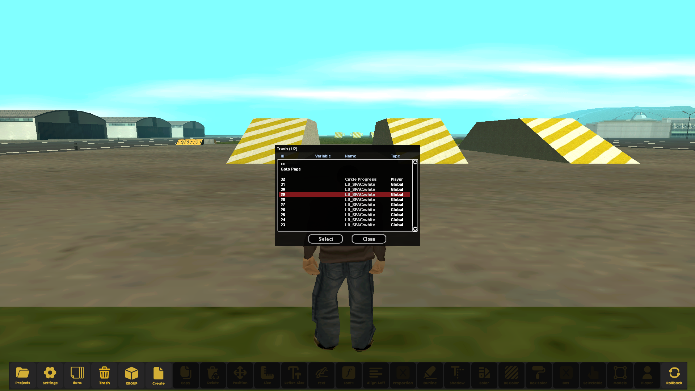
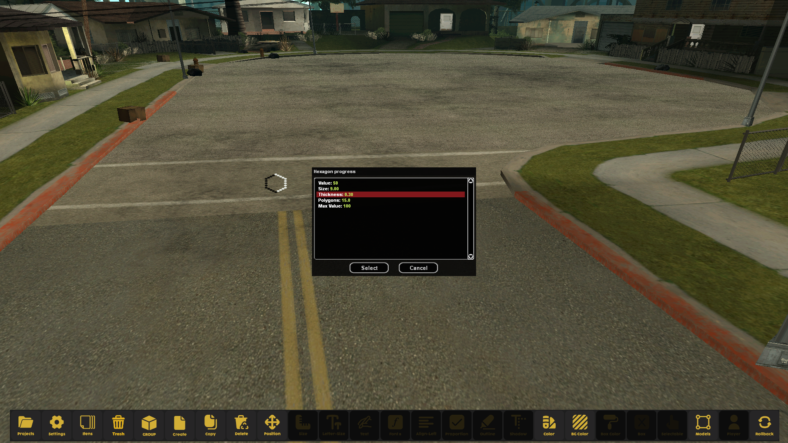
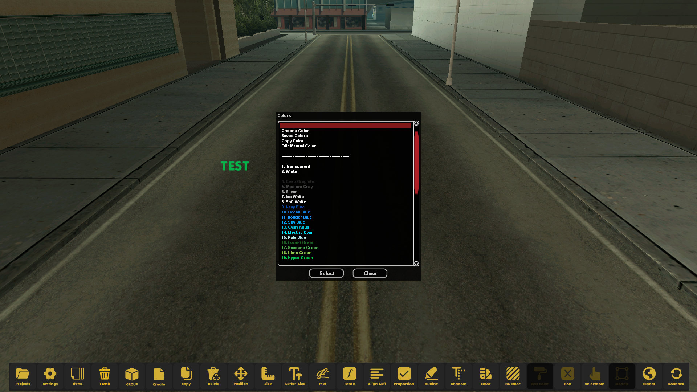
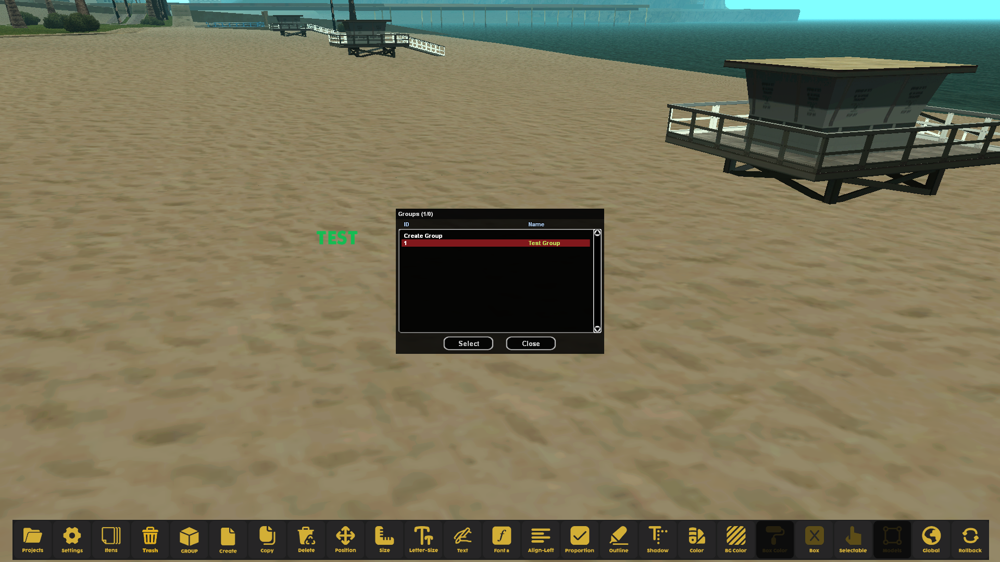
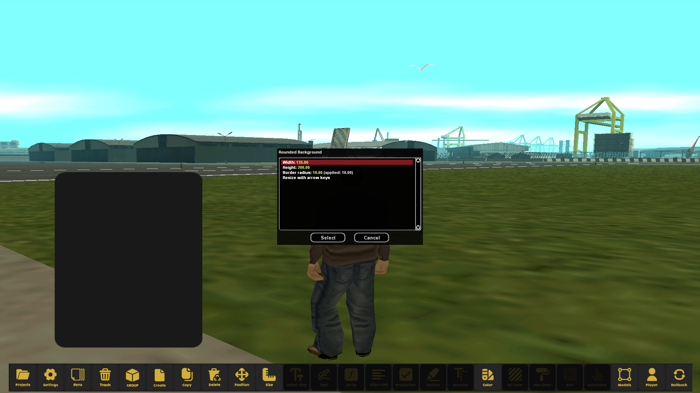
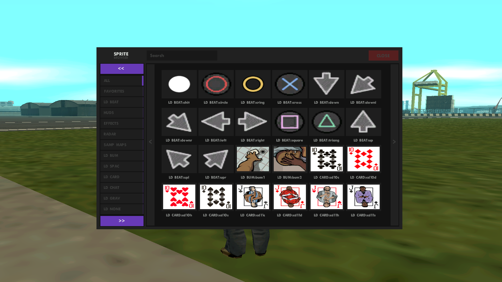
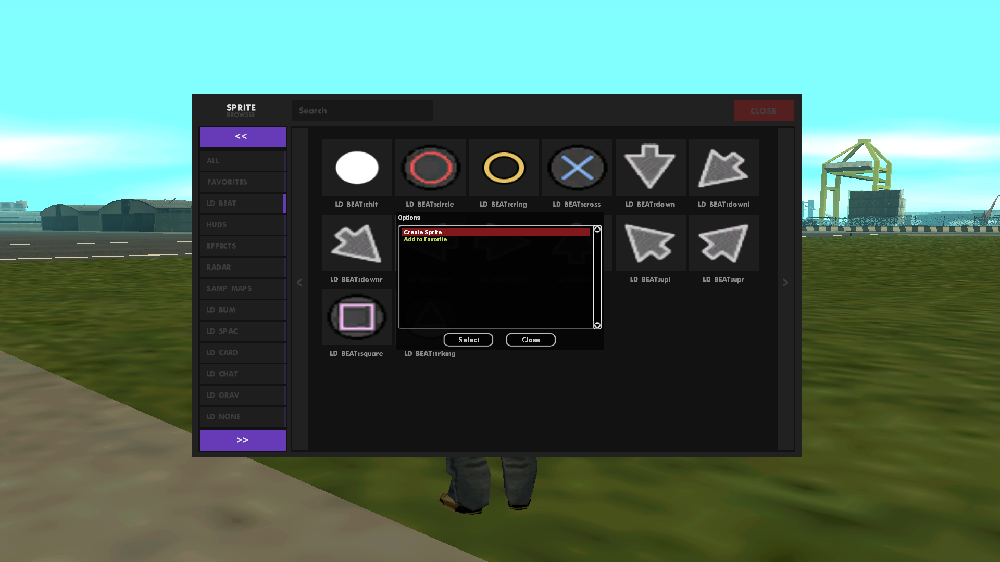
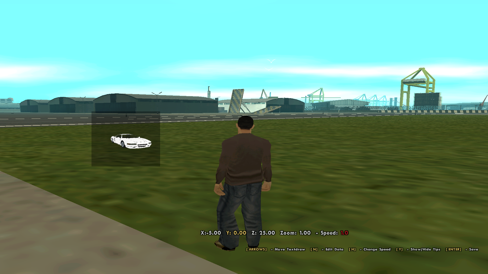
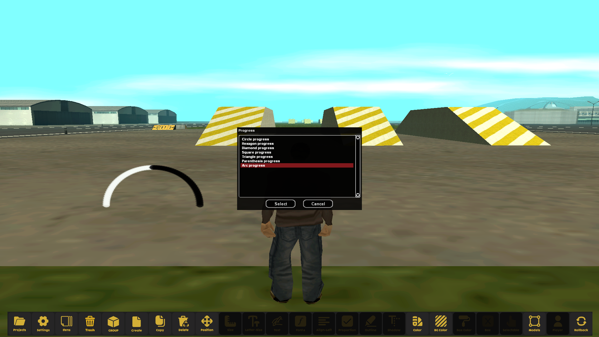

<div align="center">

# 🧋 Textdraw Studio

**A modern, collaborative textdraw editor for SA:MP and open.mp**

Explore your imagination and modernize your creations.


[Features](#-features) •
[Screenshots](#-screenshots) •
[Installation](#-installation) •
[Building](#%EF%B8%8F-building-from-source) •
[Credits](#-credits)



</div>

---

## 📖 About

**Textdraw Studio** is an in-game textdraw editor that runs as an open.mp server. Instead of designing interfaces alone in an external tool, you build them directly inside GTA: San Andreas, together with your team, in real time, and export the result ready to paste into your gamemode.

---

## ✨ Features

| Feature | Description |
|---|---|
| 👥 **Multiplayer creation** | Collaborate with other people on the same project in real time. |
| 📦 **Permanent grouping (global)** | Create groups shared by everyone to organize complex layouts. |
| 🧩 **Temporary grouping (individual)** | Select and move elements together for quick, isolated adjustments. |
| 🎞️ **Motion management** | Full control over speed, position and animation of your textdraws. |
| ⌨️ **Hotkeys & shortcuts** | Speed up your workflow with intuitive key bindings. |
| 🎥 **Dynamic camera system** | Multiple camera angles to preview your textdraws in different scenes. |
| 📤 **Export** | Export to both **legacy SA:MP** and **open.mp** syntax. |
| 📥 **Import** | Import existing legacy and open.mp projects to keep editing them. |

---

## 📷 Screenshots

<table>
  <tr>
    <td></td>
    <td></td>
    <td></td>
  </tr>
  <tr>
    <td></td>
    <td></td>
    <td></td>
  </tr>
  <tr>
    <td></td>
    <td></td>
    <td></td>
  </tr>
</table>

> Click any image to view it in full resolution.

---

## 📥 Installation

### Requirements

- GTA: San Andreas with the SA:MP client installed
- Windows (the repository ships with `omp-server.exe`)

### Steps

1. **Download** the latest version from the [Releases](../../releases) page or clone the repository:
   ```bash
   git clone https://github.com/devgreeNvg/textdraw-studio.git
   ```
2. **Install the texture file:** copy the `.txd` file from `<PATH/TO/FILE.txd>` into your GTA: SA folder at `models/txd/`.
3. **Start the server:** open the project folder and run `omp-server.exe`.
4. **Connect:** open SA:MP and join `127.0.0.1` (or `localhost`).
5. **Done!** Happy creating 🎨

> 💡 To create together with friends, they must connect to your IP instead of `localhost`, and the server port must be open on your network.

---

## 🛠️ Building from source

The project includes a ready-to-use build task for **Visual Studio Code**.

1. Open the project folder in VS Code.
2. Press **F5**.
3. Choose **Build with PowerShell**.

The build script lives at `.vscode/powershell/compiler.ps1` if you want to inspect or customize it.

---

## 📁 Project structure

```
textdraw-studio/
├── .github/workflows/   # CI workflows
├── .vscode/             # VS Code build tasks and PowerShell compiler script
├── assets/              # Screenshots and resources
├── components/          # open.mp components
├── gamemodes/           # Editor source code
├── plugins/             # Server plugins
├── qawno/               # Pawn compiler and includes
├── scriptfiles/         # Saved projects and data
├── config.json          # open.mp server configuration
├── CHANGELOG.md         # Version history
└── omp-server.exe       # open.mp server
```

---

## ⚠️ Known limitations

This project is currently in **beta**. You may run into bugs, incomplete features or inaccuracies in the English translation. If you find something, please [open an issue](../../issues), it helps a lot!

See [CHANGELOG.md](CHANGELOG.md) for the latest changes.

---

## 🤝 Contributing

Contributions are welcome!

1. Fork the repository
2. Create a branch: `git checkout -b feature/my-feature`
3. Commit your changes: `git commit -m "Add my feature"`
4. Push the branch: `git push origin feature/my-feature`
5. Open a Pull Request

Translation fixes are especially appreciated.

---

## 💙 Credits

- Created by **[blueN](https://github.com/devbluen)**, original project: [devbluen/textdraw-studio](https://github.com/devbluen/textdraw-studio)
- In collaboration with **Samp Lab**, join the community on [Discord](https://discord.gg/EqeFr5yj82)
- Built on top of [open.mp](https://open.mp)

---

<div align="center">

If this project helped you, consider leaving a ⭐ on the repository!

</div>
